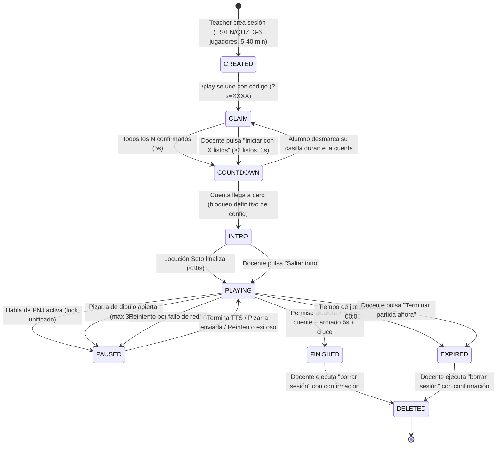

# F0-contrato.md — Contrato Técnico de Interfaz y Datos (TALENTIA / SocraticGuild)

> **Estado:** FINAL / CONTRATO F0  
> **Fecha:** 2026-11-04  
> **Fuente de verdad:** `docs/SPEC.md` (mandatorio sobre cualquier otra especificación)  
> **Referencias:** `docs/SPEC.md` §2, §11-13, §17, §19; `project.md` §6, §8; `docs/ARCHITECTURE.md`  
> **Alcance:** D1–D7 (superficie documental y UI; sin tocar 3D gameplay ni lógica de GM salvo por interfaces de contrato)

---

## 1. Alcance D1–D7 (Descripción Detallada, Especificación y Rutas)

### 1.1 Matriz de Resumen D1–D7

| ID     | Superficie / Componente                       | SPEC Origen            | Ruta                 | Actores             | Responsabilidad Principal                                                                                                                                                                                                          |
| ------ | --------------------------------------------- | ---------------------- | -------------------- | ------------------- | ---------------------------------------------------------------------------------------------------------------------------------------------------------------------------------------------------------------------------------- |
| **D1** | Configuración de Sesión y Código de Entrada   | §2, §3                 | `/teacher` y `/play` | Docente / Alumnos   | Creación de sesión (idioma, jugadores, duración), generación de código 4-char sin confusables, unión vía `?s=XXXX` y WebSocket, bloqueo de configuración al iniciar.                                                               |
| **D2** | Historial de Sesiones Pasadas y Detalle       | §2, §11                | `/teacher`           | Docente             | Listado histórico (código, fecha, idioma, jugadores, estrellas) e inspección detallada (DocenteView, transcripciones, dibujos/thumbs).                                                                                             |
| **D3** | Pantalla Final de Equipo (Victoria / Parcial) | §1, §10, §11, §12      | `/play`              | Alumnos             | Pantalla pública sin nombres ni números: arte 3D del puente, 1–3 estrellas (si finaliza), ≤3 insignias con cita en idioma de la partida, o estado parcial `Misión en curso X/3` con estrellas retenidas.                           |
| **D4** | Panel de Evaluación Docente (`DocenteView`)   | §2, §11, §13           | `/teacher`           | Docente             | Panel pedagógico en español: banner `señales preliminares, no notas`, estrellas idénticas, 5 criterios 0–2 con citas, tarjetas de alumno con anécdota y conteos de voz/dibujo, tag `con apoyo docente`.                            |
| **D5** | Hilo de Comentarios Add-Only y Borrado Seguro | §2, §11, §17           | `/teacher`           | Docente             | Hilo append-only inmutable (sin edición ni borrado de notas) + hard-delete en cascada (`borrar sesión` con confirmación, eliminando todo dato derivado por solicitud parental/Ley 29733).                                          |
| **D6** | Espejo en Vivo (Read-Only) y Consola Docente  | §2, §12, §13, §16, §17 | `/teacher`           | Docente             | Espejo 3D view-only + checklist + subtítulos + feed de transcripciones (últimos 20) y eventos + timers. Consola silenciosa: saltos a estación (`time_skip`), concesión forzada en orden, replay PNJ, retiro de jugador, reintento. |
| **D7** | Límite de Privacidad y Aislamiento de Rutas   | §2, §4, §12, §13       | `/play` y `/teacher` | Sistema / Proyector | `/play` libre de UI docente o contadores de bloqueos. Proyección en aula comparte exclusivamente la pestaña de `/play`. Mute de BGM exclusivo en `/teacher`.                                                                       |

---

### 1.2 Especificación Detallada por Entregable

#### D1: Configuración de Sesión y Código de Entrada

- **Ruta de creación:** `/teacher`
- **Ruta de unión:** `/play` (soporta auto-llenado mediante parámetro de consulta `?s=XXXX`).
- **Parámetros configurables en creación:**
  - `language`: Selector excluyente entre `ES` (Español), `EN` (Inglés) o `QUZ` (Quechua Sureño).
  - `expectedPlayers`: Número entero en el rango `[3, 6]`. Para la demo/pitch el valor por defecto es `3` o `4`.
  - `durationMinutes`: Selector en pasos de 5 minutos en el rango `[5, 40]`. Valor por defecto para demo: `5` minutos (tiempo de juego `5:00`).
- **Generación de código:** 4 caracteres alfanuméricos en mayúsculas generados aleatoriamente, excluyendo caracteres ambiguos o confusables: `0`, `O`, `1`, `I`, `L`. Alfabeto seguro: `23456789ABCDEFGHJKMNPQRSTUVWXYZ` (31 caracteres, 923,521 combinaciones posibles).
- **Bloqueo estricto de configuración:** En cuanto inicia la cuenta regresiva o la partida, la configuración se bloquea (`locked = true`). No se permite cambio de idioma, jugadores o duración a mitad de partida. Intentos de modificación generan rechazo visual (_shake_).
- **Conectividad:** Ambas rutas se conectan al mismo identificador de sesión backend mediante WebSocket bidireccional.
- **Sin autenticación:** Cero cuentas de usuario, cero perfiles de alumnos, autenticación basada exclusivamente en el código de sesión efímero.

#### D2: Historial de Sesiones Pasadas y Detalle de Inspección

- **Ruta:** `/teacher` (sección accesible desde la barra de navegación superior o pestaña dedicada).
- **Listado de sesiones:** Presenta una tabla con las sesiones almacenadas:
  - `Código` (4 caracteres alfanuméricos).
  - `Fecha y hora` (formato ISO local `YYYY-MM-DD HH:mm`).
  - `Idioma` (`ES` | `EN` | `QUZ`).
  - `Jugadores` (número de alumnos participantes).
  - `Resultado / Estrellas` (`1★`, `2★`, `3★` o `Inconclusa`).
- **Detalle de sesión:** Al seleccionar una sesión histórica se despliega:
  - Vista completa de `DocenteView` con los 5 criterios y tarjetas individuales por alumno.
  - Registro de transcripciones completas con identificación del participante y marcas de tiempo (`game_ts_ms` y `wall_ts_ms`).
  - Galería de miniaturas (_thumbnails_) de dibujos enviados junto a la extracción de visión devuelta por el modelo VLM.
  - Hilo de comentarios pedagógicos asociados, con posibilidad de añadir nuevas observaciones.

#### D3: Pantalla Final de Equipo (`/play`)

- **Ruta:** `/play` (superficie mostrada a los estudiantes y proyectada en el aula).
- **Condición de victoria (`¡Puente listo!`):**
  - Se activa únicamente tras obtener el permiso en la alcaldía, viajar al puente, completar el ensamblaje automático de 5 segundos, cruce del equipo y vítores de los PNJ.
  - Muestra animación estática con confeti y arte 3D del puente restaurado.
  - Animación emergente (_pop_) de 1 a 3 estrellas calculadas a partir de la suma de puntajes (0 a 10) de los 5 criterios del juez:
    - `0 – 4 puntos` = 1 estrella (`1★`)
    - `5 – 7 puntos` = 2 estrellas (`2★`)
    - `8 – 10 puntos` = 3 estrellas (`3★`)
  - Despliegue de hasta 3 insignias (_badges_) ganadas (criterio en `2/2`), priorizadas estrictamente según la regla:
    1. `Paso a paso` (Resolución estructurada 2/2)
    2. `Cumplieron su promesa` (Negociación 2/2)
    3. `Un solo equipo` (Colaboración 2/2)
    4. `Se turnaron` (Turn-taking 2/2)
    5. `Se organizaron` (Organización/Liderazgo 2/2)
  - Cada insignia incluye 1 línea de evidencia conductual redactada en el idioma de la sesión (`ES`, `EN` o `QUZ`).
  - Indicador de pasos completados: `3/3`.
- **Condición de tiempo expirado o terminación forzada (`Misión en curso X/3`):**
  - Se activa si el tiempo de juego llega a `00:00` o si el docente pulsa `Terminar ahora` en la consola.
  - La escena se congela en el estado actual.
  - Muestra texto locked: `Misión en curso X/3` (donde X es el número de pasos completados: 0, 1 o 2).
  - Las estrellas son **retenidas** (no se muestra ninguna estrella).
  - Se muestran únicamente las insignias ganadas hasta el momento (_badges-only_).
- **Restricción absoluta de privacidad:** CERO nombres de alumnos, CERO números o métricas individuales, CERO rankings competitivos. Todo el refuerzo es grupal y positivo.

#### D4: Panel de Evaluación Docente (`DocenteView`)

- **Ruta:** `/teacher`
- **Idioma del reporte:** Siempre en ESPAÑOL (`ES`), con independencia de si la sesión se jugó en inglés o quechua. Las citas textuales de los niños en otros idiomas se presentan parafraseadas al español en este panel.
- **Banner de advertencia obligatorio:** `señales preliminares, no notas` en la parte superior.
- **Estrellas del grupo:** Idénticas a las evaluadas para el equipo (1★ a 3★ si finalizaron; retenidas si no).
- **Distintivo de ayuda:** Si se utilizó concesión forzada (`grant_step(forced=true)`) o salto de tiempo (`time_skip`), se muestra visiblemente la etiqueta locked `con apoyo docente` y el puntaje de _Resolución estructurada_ queda capado a un máximo de 1/2.
- **5 Criterios Grupales (0 a 2 cada uno; 0 = ausente, 1 = emergente, 2 = consistente):**
  1. `turn-taking`: esperan su turno / pocas interrupciones / ceden la palabra.
  2. `colaboración`: hablan encima / reparten turnos / construyen sobre lo dicho.
  3. `negociación`: exigen / ofrecen algo / acuerdan con compromiso recordado.
  4. `resolución estructurada`: saltan pasos / reintentan tras pista / planean chacra→taller→alcaldía.
  5. `organización/liderazgo`: nadie coordina / alguien propone orden / rol de coordinación rotado o aceptado.
  - Cada criterio va acompañado de 1 cita textual o evidencia observada extraída del registro.
- **Tarjetas individuales por estudiante confirmado:**
  - Ícono / especie de animal (borde de color distintivo).
  - Nombre asignado al reclamar tarjeta (hasta 10 caracteres).
  - 3 Dimensiones observadas evaluadas de 0 a 2:
    1. `participación`: silencio (0) / 1–2 aportes (1) / interviene sostenidamente (2).
    2. `propuesta`: repite (0) / aporta idea o dibujo (1) / idea retomada por el grupo (2).
    3. `organización`: nunca ordena (0) / pide turno u orden una vez (1) / coordina o reparte roles (2).
  - Anécdota observacional de 1 línea resumida por el juez.
  - Métricas cuantitativas de telemetría: conteo total de turnos de voz y conteo total de dibujos enviados.

#### D5: Hilo de Comentarios Add-Only y Borrado Seguro de Sesión

- **Ruta:** `/teacher`
- **Hilo de comentarios pedagógicos (Add-Only):**
  - Permite al docente ingresar observaciones cualitativas en cualquier momento (durante o después de la partida).
  - Estructura: `{ id, session_id, text, author: "teacher", wall_ts_ms }`.
  - **Inmutabilidad estricta:** Registro append-only. No existe endpoint ni botón de edición, ni borrado individual de comentarios.
  - **Integridad evaluativa:** Las observaciones, citas y puntajes del juez IA son inmutables. Cualquier desacuerdo del docente queda asentado exclusivamente como comentario complementario, preservando la trazabilidad.
- **Borrado seguro de sesión (`borrar sesión`):**
  - Acción de eliminación atómica y en cascada (_hard-delete_), diseñada para atender requerimientos de supresión de datos parentales bajo la Ley 29733 de Protección de Datos Personales.
  - Requiere confirmación explícita mediante cuadro de diálogo bloqueante (`window.confirm` o modal con confirmación de dos pasos).
  - Elimina de forma irrecuperable: registro de sesión, configuración, transcripciones completas, dibujos vectoriales y rasterizados, miniaturas (_thumbs_), extracciones JSON de visión, todos los registros de eventos (los 17 tipos), puntajes del juez y el hilo completo de comentarios.
  - No requiere borrado de audio crudo ya que el sistema nunca retiene grabaciones de voz (§17).

#### D6: Espejo en Vivo (Read-Only) y Consola Docente Silenciosa

- **Ruta:** `/teacher`
- **Espejo en vivo (solo vista):**
  - Réplica sincronizada de la escena 3D (renderizada en modo pasivo, sin interacción táctil ni controles de movimiento de los personajes).
  - Indicador del checklist de 3 pasos y estado del inventario compartido (`madera`, `plano`, `sello`).
  - Subtítulos en tiempo real: líneas emitidas por los PNJ y transcripciones resultantes de las intervenciones de los niños (expiran a los 6s).
  - Registro dinámico (_feed_) de las últimas 20 transcripciones con nombre del participante.
  - Feed en vivo de eventos de telemetría (pulsaciones, vetos, solicitudes a PNJ).
  - Cronómetro de tiempo de juego (pausado durante el habla de PNJ y durante la apertura de la pizarra de dibujo), temporizador de estancamiento (_stall countdown_) y reloj de pared de depuración (_wall clock_).
  - Estado de las tarjetas de los niños: `claimed`, `confirmed`, `speaking`, `drawing`, `retired`.
- **Consola docente silenciosa:**
  - Controles de emergencia y soporte del operador que no se proyectan a los alumnos:
    - _Saltar a estación (x4):_ Teletransporte con fundido a `chacra`, `taller`, `alcaldía` o `puente`. Registra evento `time_skip`. No concede items ni altera el estado de las compuertas.
    - _Concesión forzada (`force-grant`):_ Otorga únicamente el siguiente paso pendiente en orden lineal estricto (validado por el GM; no permite saltar dos pasos consecutivos). Marca el paso como forzado y capa la resolución estructurada a 1.
    - _Replay de PNJ:_ Reemite la última locución de audio y subtítulo del PNJ activo. No genera un nuevo turno de conversación ni altera la telemetría.
    - _Terminar ahora (`end-run-now`):_ Detiene la sesión de inmediato y dispara la evaluación parcial del juez.
    - _Saltar introducción (`skip-intro`):_ Omite la locución inicial del Alcalde Soto y el paneo de cámara.
    - _Retirar alumno (`retirar`):_ Deshabilita la tarjeta de un participante específico con confirmación inline. Pasa a estado gris, deshabilita pulsadores, registra evento con marca `retirado mm:ss`. La partida continúa (incluso si queda 1 solo jugador activo, con nota del juez). No permite reincorporación.
    - _Reintentar (`reintentar`):_ Botón visible cuando falla la cascada de 3 reintentos automáticos de algún servicio de IA (STT, LLM, TTS, VLM o Juez), permitiendo al operador desbloquear la ejecución sin recurrir a degradaciones silenciosas.

#### D7: Límite de Privacidad y Aislamiento de Rutas

- **Aislamiento físico y visual:**
  - `/play` es la única ruta que se proyecta en el aula (mediante la función de "compartir pestaña" de Chrome/Edge, jamás duplicación de pantalla completa del sistema operativo).
  - `/teacher` reside exclusivamente en la pantalla local de la laptop u ordenador del operador.
  - La interfaz de `/play` está completamente desprovista de controles de consola, botones de administración o estadísticas analíticas.
  - Los contadores de intentos bloqueados (`blocked_press`) y solapamientos de voz (`suspected_overlap`) son invisibles para los niños; solo se muestran avisos transitorios de sacudida (_shake_).
- **Aislamiento de audio:**
  - El control de silenciamiento de música de fondo (`mute BGM`) existe exclusivamente en `/teacher`.
- **Cumplimiento normativo y ético:**
  - Sin captura ni procesamiento de rasgos faciales ni biométricos.
  - Cero cuentas personales persistentes para los menores de edad.
  - Datos procesados de forma efímera para generar el reporte de sesión, eliminables de inmediato ante petición de la familia o escuela.

---

### 1.3 Elementos Fuera de Alcance (Out of Scope — `SPEC.md` manda sobre `project.md`)

De acuerdo con lo estipulado en `docs/SPEC.md §0, §2` y ratificado en `PLAN.md §0`, los siguientes conceptos preliminares mencionados en `project.md §6, §8` quedan **formalmente excluidos** de la implementación de la demo:

1. **Sociograma visual:** No se construye ningún grafo interactivo de nodos o aristas de flujo colaborativo.
2. **Triage interactivo (Validar / Corregir / Descartar):** El panel docente no permite editar ni descartar los hallazgos del juez IA. Las observaciones son inmutables; el docente manifiesta su postura exclusivamente mediante el hilo de comentarios.
3. **Mapeo curricular CNEB:** No se realiza alineación automatizada ni asignación de competencias curriculares del Currículo Nacional.
4. **Seguimiento longitudinal:** No se construyen paneles de comparación temporal mensual o anual entre sesiones.
5. **Calificaciones académicas o perfiles psicométricos:** La plataforma no emite notas aprobatorias/desaprobatorias ni diagnósticos de personalidad.
6. **Multi-dispositivo para estudiantes:** La dinámica opera en 1 solo dispositivo multitáctil compartido en clase.
7. **Modo offline:** La demo requiere conectividad (LAN/GPU o proveedores de API).
8. **Portal para padres de familia:** No existe interfaz externa dedicada para apoderados.

---

## 2. Wireframes ASCII por Ruta (`/play` y `/teacher`)

### 2.1 Ruta `/play` (Interfaz de Alumnos)

#### `[PLAY-01]` Pantalla de Ingreso de Código (Estado Inicial)

```text
┌──────────────────────────────────────────────────────────────────────────────┐
│ [TALENTIA / SOCRATIC GUILD]                                    [Español v]   │
│                                                                              │
│                                                                              │
│                                ¡BIENVENIDOS!                                 │
│                                                                              │
│                 Ingresa el código de 4 letras de tu salón:                   │
│                                                                              │
│                           ┌───┬───┬───┬───┐                                  │
│                           │ K │ 7 │ B │ 9 │                                  │
│                           └───┴───┴───┴───┘                                  │
│                                                                              │
│                           [    UNIRSE    ]                                   │
│                                                                              │
│                  (El código no usa 0, O, 1, I ni L)                          │
│                                                                              │
└──────────────────────────────────────────────────────────────────────────────┘
```

#### `[PLAY-02]` Pantalla de Reclamación de Tarjetas (`claim` phase)

```text
┌──────────────────────────────────────────────────────────────────────────────┐
│ CÓDIGO: K7B9                   ¡ELIGAN SU PERSONAJE!            TIEMPO: 5:00 │
├──────────────────────────────────────────────────────────────────────────────┤
│                                                                              │
│   ┌──────────────┐  ┌──────────────┐  ┌──────────────┐  ┌──────────────┐     │
│   │  JUGADOR 1   │  │  JUGADOR 2   │  │  JUGADOR 3   │  │  JUGADOR 4   │     │
│   │              │  │              │  │              │  │              │     │
│   │    [Zorro]   │  │    [Búho]    │  │    [Rana]    │  │     [ ? ]    │     │
│   │  (Borde Rojo)│  │ (Borde Azul) │  │ (Borde Verde)│  │ (Sin elegir) │     │
│   │              │  │              │  │              │  │              │     │
│   │ Nombre:      │  │ Nombre:      │  │ Nombre:      │  │ Toca para    │     │
│   │ [ "Mateo"  ] │  │ [ "Sofía"  ] │  │ [ "Lucas"  ] │  │ reclamar...   │     │
│   │              │  │              │  │              │  │              │     │
│   │   [✓ LISTO]  │  │   [✓ LISTO]  │  │   [✓ LISTO]  │  │   [       ]  │     │
│   └──────────────┘  └──────────────┘  └──────────────┘  └──────────────┘     │
│                                                                              │
│   [ Selector modal de 8 animales: Zorro, Búho, Rana, Gato, Llama, Tucán... ] │
│                                                                              │
│   >> Todos listos: Iniciando en 5... (o espera inicio del profesor)          │
└──────────────────────────────────────────────────────────────────────────────┘
```

#### `[PLAY-03]` Pantalla Principal de Juego Activo

```text
┌──────────────────────────────────────────────────────────────────────────────┐
│ [04:15]                      TALENTIA: PUENTE                   [ES]         │
├──────────────────────────────────────────────────────┬───────────────────────┤
│                                                      │ [Zorro] MATEO (Rojo)  │
│                                                      │  ┌─────────────────┐  │
│                                                      │  │ (•) MANTÉN HABLAR│  │
│                      ESCENA 3D                       │  │ [~] MANTÉN DIBUJO│  │
│                 DIORAMA BILLBOARD (~70%)             │  │   Estado: Libre  │  │
│                                                      │  └─────────────────┘  │
│              [Campamento]  ->  [Chacra]              │ [Búho] SOFÍA (Azul)   │
│                                                      │  ┌─────────────────┐  │
│                                                      │  │ (•) MANTÉN HABLAR│  │
│             [Taller]      ->   [Alcaldía]            │  │ [~] MANTÉN DIBUJO│  │
│                                                      │  │   Estado: Habla..│  │
│                        v                             │  └─────────────────┘  │
│                   [Puente Roto]                      │ [Rana] LUCAS (Verde)  │
│                                                      │  ┌─────────────────┐  │
│                                                      │  │ (•) MANTÉN HABLAR│  │
│                                                      │  │ [~] MANTÉN DIBUJO│  │
│                                                      │  │   Estado: Libre  │  │
│                                                      │  └─────────────────┘  │
├──────────────────────────────────────────────────────┴───────────────────────┤
│ [MINIMAPA]   [SUBTÍTULOS ACTIVOS: 2 LÍNEAS / 6 SEG]                          │
│   ( o )      Paco: "Necesitamos brazos fuertes para podar las vigas..."      │
│   ~100px     Sofía: "¡Nosotros podemos ayudarte con la cosecha primero!"     │
├──────────────────────────────────────────────────────────────────────────────┤
│ PASOS: [x] 1. Conseguir madera  ->  [ ] 2. Aprobar diseño  ->  [ ] 3. Permiso │
│ INVENTARIO: [Madera: ✓]   [Plano:  ]   [Sello:  ]                            │
└──────────────────────────────────────────────────────────────────────────────┘
```

#### `[PLAY-04]` Modal / Overlay de Dibujo Pantalla Completa

```text
┌──────────────────────────────────────────────────────────────────────────────┐
│ PIZARRA DE DIBUJO — [Rana] LUCAS                     Tiempo restante: ( 22s )│
├──────────────────────────────────────────────────────────────────────────────┤
│                                                                              │
│    HERRAMIENTAS:                                                             │
│    Colores: [Negro] [Rojo] [Azul] [Verde] [Amarillo]                         │
│    Pincel: (● Grueso)        [ Deshacer x20 ]        [ Limpiar lienzo ]      │
│                                                                              │
│    ┌────────────────────────────────────────────────────────────────────┐    │
│    │                                                                    │    │
│    │                  ~ ~ ~ ~ [RÍO CAUDALOSO] ~ ~ ~ ~                   │    │
│    │             /======\                          /======\             │    │
│    │            /        \========================/        \            │    │
│    │           | ORILLA A |      [VIGA MADERA]   | ORILLA B |           │    │
│    │           |          |                      |          |           │    │
│    │                                                                    │    │
│    └────────────────────────────────────────────────────────────────────┘    │
│                                                                              │
│    (Auto-envío al terminar los 30s)                       [ ✓ LISTO / ENVIAR]│
└──────────────────────────────────────────────────────────────────────────────┘
```

#### `[PLAY-05]` Modal de Mapa de Estaciones y Voto de Movimiento

```text
┌──────────────────────────────────────────────────────────────────────────────┐
│ MAPA DE LA COMUNIDAD — ¿A DÓNDE VAMOS?                                 [ X ] │
├──────────────────────────────────────────────────────────────────────────────┤
│                                                                              │
│   BANNER: ¿Vamos a taller? propuso Sofía, mantén para vetar ( 4s )           │
│                                                                              │
│        ┌──────────────┐              ┌──────────────┐                        │
│        │ [1] CHACRA   │              │ [2] TALLER   │ [OBJETIVO PROPUESTO]   │
│        │ (Completado) │              │ Ing. Luz     │                        │
│        └──────────────┘              └──────────────┘                        │
│                                                                              │
│        ┌──────────────┐              ┌──────────────┐                        │
│        │ [3] ALCALDÍA │              │ [4] PUENTE   │                        │
│        │ Alcalde Soto │              │ (Destino)    │                        │
│        └──────────────┘              └──────────────┘                        │
│                                                                              │
│   Votación en curso (20s): Habla para votar o espera confirmación.           │
│   [Sofía: Taller]   [Mateo: Taller]   [Lucas: Esperando...]                  │
│                                                                              │
│   >> ¡Vamos a taller! (Cerrando mapa y caminando en grupo...)                │
└──────────────────────────────────────────────────────────────────────────────┘
```

#### `[PLAY-06]` Pantalla Final de Equipo — Victoria (`¡Puente listo!`)

```text
┌──────────────────────────────────────────────────────────────────────────────┐
│                              ¡PUENTE LISTO!                                  │
│                         ★ ★ ★ (3 ESTRELLAS) ★ ★ ★                            │
├──────────────────────────────────────────────────────────────────────────────┤
│                                                                              │
│                   * * *   ¡CONFUDIÓ EL ESFUERZO!   * * *                     │
│                        /========================\                            │
│                       /    [PUENTE REPARADO]     \                           │
│                      |____________________________|                          │
│                                                                              │
│                 ¡El pueblo entero cruza y celebra juntos!                    │
│                                                                              │
│   LOGROS DEL EQUIPO (3/3 completados):                                       │
│                                                                              │
│   ┌────────────────────────┐ ┌────────────────────────┐ ┌──────────────────┐ │
│   │ [★] PASO A PASO        │ │ [★] UN SOLO EQUIPO     │ │ [★] SE TURNARON  │ │
│   │ "Construyeron en orden │ │ "Escucharon las ideas  │ │ "Esperaron que   │ │
│   │ exacto la solución"    │ │ de todos sin pisarse"  │ │ cada uno hable"  │ │
│   └────────────────────────┘ └────────────────────────┘ └──────────────────┘ │
│                                                                              │
│                (Cero nombres de alumnos • Cero notas numéricas)              │
└──────────────────────────────────────────────────────────────────────────────┘
```

#### `[PLAY-07]` Pantalla Final de Equipo — Inconclusa (`Misión en curso X/3`)

```text
┌──────────────────────────────────────────────────────────────────────────────┐
│                           MISIÓN EN CURSO 2/3                                │
│                          (Estrellas retenidas)                               │
├──────────────────────────────────────────────────────────────────────────────┤
│                                                                              │
│                     Se agotó el tiempo de la aventura                        │
│                   ¡Buen intento, el equipo avanzó mucho!                     │
│                                                                              │
│   LOGROS ALCANZADOS HASTA AHORA:                                             │
│                                                                              │
│   ┌────────────────────────┐ ┌────────────────────────┐                      │
│   │ [★] PASO A PASO        │ │ [★] SE TURNARON        │                      │
│   │ "Recolectaron madera y │ │ "Respetaron los turnos │                      │
│   │ diseñaron los planos"  │ │ al conversar"          │                      │
│   └────────────────────────┘ └────────────────────────┘                      │
│                                                                              │
│               El puente quedó a medio camino, ¡a seguir intentando!          │
└──────────────────────────────────────────────────────────────────────────────┘
```

---

### 2.2 Ruta `/teacher` (Interfaz del Docente / Operador)

#### `[TEACH-01]` Formulario de Nueva Sesión y Exhibición de Código

```text
┌──────────────────────────────────────────────────────────────────────────────┐
│ PANEL DOCENTE — TALENTIA OPERADOR              [Sesiones Pasadas] [Mute BGM] │
├──────────────────────────────────────────────────────────────────────────────┤
│                                                                              │
│   CREAR NUEVA SESIÓN DE JUEGO                                                │
│                                                                              │
│   Idioma de la partida:       [ (•) Español | ( ) English | ( ) Quechua ]    │
│                                                                              │
│   Número de alumnos esperados: [ 3 ] [ 4 ] [ 5 ] [ 6 ]   (Demo: 3-4)         │
│                                                                              │
│   Duración límite de juego:   [ 5 min (Demo) ] (Selector 5 a 40 min)         │
│                                                                              │
│   [  GENERAR NUEVA SESIÓN  ]                                                 │
│                                                                              │
│ ───────────────────────────────────────────────────────────────────────────  │
│   SESIÓN ACTIVA GENERADA:                                                    │
│                                                                              │
│         CÓDIGO: [ K 7 B 9 ]               ESTADO: Esperando jugadores (0/4)  │
│                                                                              │
│         Enlace directo para proyector: https://app.talentia.edu/play?s=K7B9  │
│                                                                              │
│   [ INICIAR CON 2 LISTOS (Forzar) ]      (Aparece cuando al menos 2 listos)  │
└──────────────────────────────────────────────────────────────────────────────┘
```

#### `[TEACH-02]` Espejo en Vivo y Consola Docente Silenciosa

```text
┌──────────────────────────────────────────────────────────────────────────────┐
│ SESIÓN: K7B9 | IDIOMA: ES | TIEMPO: [03:42] | ESTANCAMIENTO: 35s | WALL: 14:22│
├──────────────────────────────────────┬───────────────────────────────────────┤
│ [ESPEJO 3D — SOLO VISTA]             │ REGISTRO DE CONVERSACIÓN (Últimos 20) │
│                                      │ 14:21:05 [Mateo]: "Hola Paco venimos" │
│   Estación actual: Chacra (Paco)     │ 14:21:12 [Paco]: "¿Quién ayuda y en.. │
│   Progreso: 1/3 (Madera obtenida)    │ 14:21:25 [Sofía]: "Yo cargo leña"     │
│   Subtítulo: "¡Trato hecho amigos!"  │ 14:21:30 [Lucas]: "Y yo vigilo"       │
│                                      ├───────────────────────────────────────┤
│   Participantes en vivo:             │ EVENTOS DEL SISTEMA                   │
│   [Zorro] Mateo:   Libre             │ 14:21:28 grant_step (chacra, auto)    │
│   [Búho]  Sofía:   Hablando (3s)     │ 14:21:35 move_propose (-> taller)     │
│   [Rana]  Lucas:   Libre             │ 14:21:40 move_execute (walk 8s)       │
├──────────────────────────────────────┴───────────────────────────────────────┤
│ CONSOLA DOCENTE SILENCIOSA (No proyectada en /play)                          │
│                                                                              │
│ Saltar estación: [-> Chacra]  [-> Taller]  [-> Alcaldía]  [-> Puente]        │
│ Acciones:        [ Concesión forzada (Next) ]  [ Replay PNJ ]  [ Skip Intro] │
│ Alumnos:         Retirar: [ Mateo (x) ] [ Sofía (x) ] [ Lucas (x) ]          │
│ Emergencia:      [ Reintentar conexión ]       [ TERMINAR PARTIDA AHORA ]    │
└──────────────────────────────────────────────────────────────────────────────┘
```

#### `[TEACH-03]` Panel de Evaluación Docente (`DocenteView`)

```text
┌──────────────────────────────────────────────────────────────────────────────┐
│ [ BANNER: SEÑALES PRELIMINARES, NO NOTAS ]                       SESIÓN: K7B9│
│ RESULTADO FINAL: ★ ★ ★ (3 Estrellas)       [ con apoyo docente ] (si aplica) │
├──────────────────────────────────────────────────────────────────────────────┤
│ 1. CRITERIOS GRUPALES (0-2)                                                  │
│                                                                              │
│ • Turn-taking (2/2):           "Esperaron pacientemente cada turno sin pisar"│
│ • Colaboración (2/2):          "Sofía complementó el diseño que dibujó Lucas"│
│ • Negociación (2/2):           "Acordaron repartirse las tareas con el PNJ"  │
│ • Resolución estructurada (1/2): "Avanzaron ordenadamente tras recibir pista"│
│ • Organización/Liderazgo (2/2):"Mateo propuso las votaciones de movimiento" │
├──────────────────────────────────────────────────────────────────────────────┤
│ 2. OBSERVACIÓN POR ESTUDIANTE (Cualitativa y Formativa)                      │
│                                                                              │
│ [Zorro] MATEO (Borde Rojo)                                                   │
│   Participación: 2/2  |  Propuesta: 2/2  |  Organización: 2/2                │
│   Turnos voz: 12      |  Dibujos: 1                                          │
│   Anécdota: "Asumió la iniciativa en el mapa y consultó la opinión del grupo"│
│                                                                              │
│ [Búho] SOFÍA (Borde Azul)                                                    │
│   Participación: 2/2  |  Propuesta: 2/2  |  Organización: 1/2                │
│   Turnos voz: 10      |  Dibujos: 0                                          │
│   Anécdota: "Negoció hábilmente con el Alcalde recordando el trato previo"   │
│                                                                              │
│ [Rana] LUCAS (Borde Verde)                                                   │
│   Participación: 1/2  |  Propuesta: 2/2  |  Organización: 0/2                │
│   Turnos voz: 4       |  Dibujos: 2                                          │
│   Anécdota: "Se comunicó principalmente mediante bocetos claros en la pizarra"│
└──────────────────────────────────────────────────────────────────────────────┘
```

#### `[TEACH-04]` Hilo de Comentarios Add-Only y Controles de Sesión

```text
┌──────────────────────────────────────────────────────────────────────────────┐
│ NOTAS Y COMENTARIOS DEL DOCENTE (Registro Add-Only Inmutable)                │
├──────────────────────────────────────────────────────────────────────────────┤
│ [14:35 - Docente]: "Excelente coordinación entre Mateo y Sofía en el taller."│
│ [14:40 - Docente]: "Lucas demostró gran pensamiento espacial con el dibujo." │
│                                                                              │
│ ┌──────────────────────────────────────────────────────────────────────────┐ │
│ │ Escribe una observación pedagógica sobre esta sesión...                  │ │
│ └──────────────────────────────────────────────────────────────────────────┘ │
│ [ + AGREGAR COMENTARIO ]         (No se permite editar ni borrar comentarios)│
├──────────────────────────────────────────────────────────────────────────────┤
│ PRIVACIDAD Y DERECHOS ARCO:                                                  │
│ [ BORRAR SESIÓN (Hard Delete) ]  -> Abre modal de confirmación irreversible  │
└──────────────────────────────────────────────────────────────────────────────┘
```

#### `[TEACH-05]` Listado de Sesiones Pasadas y Modal de Borrado

```text
┌──────────────────────────────────────────────────────────────────────────────┐
│ HISTORIAL DE SESIONES PASADAS                                                │
├────────┬──────────────────┬────────┬───────────┬─────────────┬───────────────┤
│ CÓDIGO │ FECHA / HORA     │ IDIOMA │ JUGADORES │ RESULTADO   │ ACCIONES      │
├────────┼──────────────────┼────────┼───────────┼─────────────┼───────────────┤
│ K7B9   │ 2026-11-04 14:15 │ ES     │ 3 niños   │ ★★★ (3)     │ [Ver Detalle] │
│ M2P4   │ 2026-11-04 11:30 │ QUZ    │ 4 niños   │ ★★  (2)     │ [Ver Detalle] │
│ T8X1   │ 2026-11-03 16:00 │ EN     │ 3 niños   │ Inconclusa  │ [Ver Detalle] │
└────────┴──────────────────┴────────┴───────────┴─────────────┴───────────────┘
│                                                                              │
│ ┌──────────────────────────────────────────────────────────────────────────┐ │
│ │ MODAL: ¿Eliminar definitivamente la sesión K7B9?                         │ │
│ │ Esta acción borrará transcripciones, dibujos, eventos y puntajes de       │ │
│ │ forma irreversible (Ley 29733 / Solicitud de Padres).                    │ │
│ │                                                                          │ │
│ │            [ CANCELAR ]           [ SÍ, BORRAR DEFINITIVAMENTE ]         │ │
│ └──────────────────────────────────────────────────────────────────────────┘ │
└──────────────────────────────────────────────────────────────────────────────┘
```

---

## 3. Contratos TypeScript Completos y Rigurosos

A continuación se formalizan las definiciones TypeScript del dominio, contratos de eventos, modelos de persistencia e interfaces de puertos.

```typescript
/**
 * TALENTIA / SocraticGuild — Domain Type Definitions & Contracts
 * Documento contractual para D1–D7 bajo SPEC.md (FINAL).
 */

// ============================================================================
// 1. TIPOS PRIMITIVOS Y ENUMS LITERALES
// ============================================================================

export type Language = "ES" | "EN" | "QUZ";

export type AvatarSpecies =
	| "Zorro"
	| "Búho"
	| "Rana"
	| "Gato"
	| "Llama"
	| "Tucán"
	| "Ratón"
	| "Tortuga";

export type StationId =
	| "campamento"
	| "chacra"
	| "taller"
	| "alcaldía"
	| "puente";

export type InventoryItemId = "madera" | "plano" | "sello";

export type ChecklistStepId =
	| "conseguir_madera"
	| "aprobar_diseno"
	| "permiso_alcaldia";

export type ChecklistStatus = "todo" | "active" | "done";

export type PlayerCardStatus =
	| "idle"
	| "recording"
	| "locked"
	| "other_speaking"
	| "drawing"
	| "npc_speaking"
	| "walking"
	| "retired";

export type SendReason = "release" | "silence" | "autocut";

export type HintTier = "L1" | "L2" | "L3";

export type CriterionScore = 0 | 1 | 2;

export type StarRating = 1 | 2 | 3;

export type BadgeId =
	| "paso_a_paso"
	| "cumplieron_su_promesa"
	| "un_solo_equipo"
	| "se_turnaron"
	| "se_organizaron";

export type SessionStatus =
	| "created"
	| "claim"
	| "countdown"
	| "intro"
	| "playing"
	| "paused"
	| "finished"
	| "expired"
	| "deleted";

export type DrawingColor = "negro" | "rojo" | "azul" | "verde" | "amarillo";

// ============================================================================
// 2. CONFIGURACIÓN Y ESTADO DE SESIÓN
// ============================================================================

export interface SessionConfig {
	/** Idioma monoglota fijado al inicio */
	readonly language: Language;
	/** Cantidad de jugadores esperados: 3 a 6 */
	readonly expectedPlayers: number;
	/** Duración de la partida en minutos (5 a 40, paso de 5) */
	readonly durationMinutes: number;
	/** Duración de la partida en milisegundos de tiempo de juego (ej. 300000 para 5 min) */
	readonly durationGameMs: number;
	/** Marca de tiempo de pared de creación */
	readonly createdAtWallMs: number;
	/** Bandera de bloqueo. Al iniciar queda bloqueada permanentemente */
	readonly locked: boolean;
}

export interface PlayerCard {
	readonly slotIndex: number;
	readonly playerId: string;
	readonly avatar: AvatarSpecies;
	readonly name: string; // Máximo 10 caracteres
	readonly confirmed: boolean;
	readonly retired: boolean;
	readonly retiredGameTsMs: number | null;
	readonly lastActiveWallMs: number;
	readonly turnCount: number;
	readonly drawCount: number;
}

export interface SharedInventory {
	readonly madera: boolean;
	readonly plano: boolean;
	readonly sello: boolean;
}

export interface ChecklistStep {
	readonly stepNumber: 1 | 2 | 3;
	readonly id: ChecklistStepId;
	readonly station: StationId;
	readonly status: ChecklistStatus;
	readonly forced: boolean;
}

// ============================================================================
// 3. DIBUJO Y LECTURA DE VISIÓN (VLM)
// ============================================================================

export interface DrawStroke {
	readonly color: DrawingColor;
	readonly brushSize: number;
	readonly points: Array<{ x: number; y: number; timeOffsetMs: number }>;
}

export interface VisionRead {
	readonly objects: string[];
	readonly actions: string[];
	readonly measures: string[];
	readonly routes: string[];
	readonly labelsOrMarks: string[];
	readonly confidence: Record<string, number>;
	readonly rawResponse: string;
}

export interface DrawSubmission {
	readonly id: string;
	readonly stationId: StationId;
	readonly playerId: string;
	readonly strokes: DrawStroke[];
	readonly imageJpegBase64: string; // JPEG comprimido <= 1024px
	readonly thumbBase64: string; // Miniatura para reporte
	readonly gameTsMs: number;
	readonly wallTsMs: number;
	readonly visionRead: VisionRead | null;
}

// ============================================================================
// 4. TRANSCRIPCIONES DIARIZADAS
// ============================================================================

export interface TranscriptTurn {
	readonly id: string;
	readonly turnIndex: number;
	readonly holderPlayerId: string;
	readonly audioDurationMs: number;
	readonly sendReason: SendReason;
	readonly rawText: string;
	readonly paraphraseEs: string;
	readonly suspectedOverlap: boolean;
	readonly gameTsMs: number;
	readonly wallTsMs: number;
}

// ============================================================================
// 5. REGISTRO DE EVENTOS (CLOSED EVENT LOG: 17 TIPOS + JUDGE_SCORES)
// ============================================================================

export type EventType =
	| "press"
	| "blocked_press"
	| "speech_start"
	| "speech_end"
	| "transcript"
	| "suspected_overlap"
	| "draw_start"
	| "draw_submit"
	| "vision_read"
	| "move_propose"
	| "move_veto"
	| "move_execute"
	| "refusal"
	| "hint_level"
	| "grant_step"
	| "npc_line"
	| "time_skip"
	| "judge_scores";

export interface PressPayload {
	readonly targetType: "talk" | "draw" | "map" | "card";
	readonly buttonId: string;
}

export interface BlockedPressPayload {
	readonly reason:
		| "npc_speaking"
		| "other_speaking"
		| "draw_active"
		| "walk_active"
		| "draw_cap_reached";
	readonly currentActiveSpeakerId: string | null;
}

export interface SpeechStartPayload {
	readonly audioSessionId: string;
}

export interface SpeechEndPayload {
	readonly durationMs: number;
	readonly sendReason: SendReason;
}

export interface TranscriptPayload {
	readonly transcriptId: string;
	readonly text: string;
	readonly sendReason: SendReason;
}

export interface SuspectedOverlapPayload {
	readonly detectedClues: string[];
	readonly rawTranscriptSnippet: string;
}

export interface DrawStartPayload {
	readonly stationId: StationId;
}

export interface DrawSubmitPayload {
	readonly drawSubmissionId: string;
	readonly strokeCount: number;
	readonly wasEmpty: boolean;
}

export interface VisionReadPayload {
	readonly drawSubmissionId: string;
	readonly visionRead: VisionRead;
}

export interface MoveProposePayload {
	readonly fromStation: StationId;
	readonly toStation: StationId;
	readonly proposerPlayerId: string;
	readonly proposalMethod: "voice" | "map_tap";
}

export interface MoveVetoPayload {
	readonly vetoerPlayerId: string;
	readonly targetStation: StationId;
	readonly vetoSpeechTranscript: string;
}

export interface MoveExecutePayload {
	readonly destinationStation: StationId;
	readonly walkDurationMs: number;
}

export interface RefusalPayload {
	readonly npcId: string;
	readonly stationId: StationId;
	readonly missingRequirement: string;
	readonly isOutOfOrder: boolean;
}

export interface HintLevelPayload {
	readonly tier: HintTier;
	readonly npcId: string;
	readonly stationId: StationId;
	readonly messageText: string;
}

export interface GrantStepPayload {
	readonly stepId: ChecklistStepId;
	readonly grantedItem: InventoryItemId | null;
	readonly forced: boolean;
}

export interface NpcLinePayload {
	readonly npcId: string;
	readonly stationId: StationId;
	readonly text: string;
	readonly audioDurationMs: number;
}

export interface TimeSkipPayload {
	readonly fromStation: StationId;
	readonly toStation: StationId;
	readonly triggeredBy: "teacher_console";
}

export interface JudgeScoresPayload {
	readonly judgeScoresId: string;
	readonly sumPoints: number;
	readonly stars: StarRating | null;
	readonly conApoyoDocente: boolean;
}

export type EventPayloadMap = {
	press: PressPayload;
	blocked_press: BlockedPressPayload;
	speech_start: SpeechStartPayload;
	speech_end: SpeechEndPayload;
	transcript: TranscriptPayload;
	suspected_overlap: SuspectedOverlapPayload;
	draw_start: DrawStartPayload;
	draw_submit: DrawSubmitPayload;
	vision_read: VisionReadPayload;
	move_propose: MoveProposePayload;
	move_veto: MoveVetoPayload;
	move_execute: MoveExecutePayload;
	refusal: RefusalPayload;
	hint_level: HintLevelPayload;
	grant_step: GrantStepPayload;
	npc_line: NpcLinePayload;
	time_skip: TimeSkipPayload;
	judge_scores: JudgeScoresPayload;
};

export interface EventLogEntry<T extends EventType = EventType> {
	readonly id: string;
	readonly sessionId: string;
	readonly type: T;
	readonly game_ts_ms: number;
	readonly wall_ts_ms: number;
	readonly actorId: string; // playerId, npcId o "teacher"
	readonly payload: EventPayloadMap[T];
}

// ============================================================================
// 6. EVALUACIÓN PEDAGÓGICA Y MODELO DEL JUEZ (JUDGE)
// ============================================================================

export interface GroupCriterionEvaluation {
	readonly score: CriterionScore;
	readonly evidenceQuote: string; // Cita textual o paráfrasis en español
}

export interface GroupCriteriaBreakdown {
	readonly turnTaking: GroupCriterionEvaluation;
	readonly colaboracion: GroupCriterionEvaluation;
	readonly negociacion: GroupCriterionEvaluation;
	readonly resolucionEstructurada: GroupCriterionEvaluation;
	readonly organizacionLiderazgo: GroupCriterionEvaluation;
}

export interface StudentEvaluation {
	readonly playerId: string;
	readonly avatar: AvatarSpecies;
	readonly name: string;
	readonly participacion: CriterionScore;
	readonly propuesta: CriterionScore;
	readonly organizacion: CriterionScore;
	readonly anecdote: string;
	readonly turnCount: number;
	readonly drawCount: number;
}

export interface BadgeAward {
	readonly id: BadgeId;
	readonly name: string;
	readonly quoteInRunLanguage: string;
}

export interface JudgeScores {
	readonly id: string;
	readonly sessionId: string;
	readonly sumPoints: number; // 0 a 10
	readonly stars: StarRating | null; // null si no terminó
	readonly isFinished: boolean;
	readonly earnedBadges: BadgeAward[]; // Máximo 3, ordenadas por prioridad
	readonly groupCriteria: GroupCriteriaBreakdown;
	readonly students: StudentEvaluation[];
	readonly conApoyoDocente: boolean;
	readonly evaluatedAtWallMs: number;
}

export interface JudgeEvaluationContext {
	readonly config: SessionConfig;
	readonly players: readonly PlayerCard[];
	readonly transcripts: readonly TranscriptTurn[];
	readonly drawings: readonly DrawSubmission[];
	readonly events: readonly EventLogEntry[];
	readonly hasTeacherSupport: boolean;
}

// ============================================================================
// 7. HILO DE COMENTARIOS (ADD-ONLY)
// ============================================================================

export interface SessionComment {
	readonly id: string;
	readonly sessionId: string;
	readonly text: string;
	readonly author: "teacher";
	readonly wall_ts_ms: number;
}

// ============================================================================
// 8. REGISTRO COMPLETO DE SESIÓN (SESSION RECORD)
// ============================================================================

export interface SessionRecord {
	readonly id: string;
	readonly code: string; // 4 caracteres excluyendo 0, O, 1, I, L
	readonly config: SessionConfig;
	readonly status: SessionStatus;
	readonly currentStation: StationId;
	readonly gameTimeRemainingMs: number;
	readonly stallCountdownSeconds: number;
	readonly players: PlayerCard[];
	readonly inventory: SharedInventory;
	readonly checklist: ChecklistStep[];
	readonly transcripts: TranscriptTurn[];
	readonly drawings: DrawSubmission[];
	readonly events: EventLogEntry[];
	readonly scores: JudgeScores | null;
	readonly comments: SessionComment[];
	readonly createdAtWallMs: number;
	readonly updatedAtWallMs: number;
}

export interface SessionSummary {
	readonly code: string;
	readonly createdAtWallMs: number;
	readonly language: Language;
	readonly playerCount: number;
	readonly stars: StarRating | null;
	readonly isFinished: boolean;
	readonly conApoyoDocente: boolean;
}

// ============================================================================
// 9. FUNCIONES DE DOMINIO PURAS (CONTRATO MATEMÁTICO)
// ============================================================================

/**
 * Generación de código de 4 caracteres sin caracteres confusables (0, O, 1, I, L).
 */
export function codeGen(): string;

/**
 * Mapeo de puntaje acumulado (0-10) a estrellas (1-3★).
 * Condición obligatoria: La partida debe haber finalizado con éxito.
 * Si no finalizó (tiempo expirado o aborto), devuelve null (estrellas retenidas).
 */
export function calculateStars(
	sumPoints: number,
	isFinished: boolean,
): StarRating | null {
	if (!isFinished) return null;
	if (sumPoints <= 4) return 1;
	if (sumPoints <= 7) return 2;
	return 3;
}

export const starsFor = calculateStars;

/**
 * Prioridad estricta de insignias cuando se obtienen más de 3:
 * 1. Paso a paso (resolucionEstructurada == 2)
 * 2. Cumplieron su promesa (negociacion == 2)
 * 3. Un solo equipo (colaboracion == 2)
 * 4. Se turnaron (turnTaking == 2)
 * 5. Se organizaron (organizacionLiderazgo == 2)
 */
export const BADGE_PRIORITY_ORDER: readonly BadgeId[] = [
	"paso_a_paso",
	"cumplieron_su_promesa",
	"un_solo_equipo",
	"se_turnaron",
	"se_organizaron",
] as const;

export function filterAndPrioritizeBadges(earnedBadges: BadgeId[]): BadgeId[] {
	return BADGE_PRIORITY_ORDER.filter((badge) =>
		earnedBadges.includes(badge),
	).slice(0, 3);
}

export const badgePriority = filterAndPrioritizeBadges;

// ============================================================================
// 10. INTERFACES DE PUERTOS Y REPOSITORIOS
// ============================================================================

export interface ISessionRepository {
	create(config: SessionConfig): Promise<SessionRecord>;
	getByCode(code: string): Promise<SessionRecord | null>;
	listPast(): Promise<SessionSummary[]>;
	updateStatus(code: string, status: SessionStatus): Promise<void>;
	addComment(code: string, text: string): Promise<SessionComment>;
	saveScores(code: string, scores: JudgeScores): Promise<void>;
	/**
	 * Borrado en cascada definitivo.
	 * Elimina sesión, eventos, dibujos, transcripciones, puntajes y comentarios.
	 */
	hardDelete(code: string): Promise<boolean>;
}

export interface IEventLogPort {
	append<T extends EventType>(
		entry: Omit<EventLogEntry<T>, "id">,
	): Promise<EventLogEntry<T>>;
	getBySession(sessionId: string): Promise<EventLogEntry[]>;
}

export interface IJudgeService {
	evaluateSession(context: JudgeEvaluationContext): Promise<JudgeScores>;
}
```

---

## 4. Máquina de Estados de la Sesión

### 4.1 Definición de Estados

| Estado      | Descripción                                                                                                                  | Transición Siguiente                         |
| ----------- | ---------------------------------------------------------------------------------------------------------------------------- | -------------------------------------------- |
| `CREATED`   | Sesión instanciada en `/teacher`. Código de 4 caracteres generado. Esperando conexión desde `/play`.                         | `CLAIM`                                      |
| `CLAIM`     | Ruta `/play` conectada. Los niños reclaman tarjetas, eligen avatar (8 animales) y nombre. Se permite cancelación individual. | `COUNTDOWN`                                  |
| `COUNTDOWN` | Cuenta regresiva activa: 5s si todos los N están listos, o 3s si el docente forza el inicio con ≥2 confirmados.              | `INTRO` (o vuelve a `CLAIM` si se desmarcan) |
| `INTRO`     | Locución del Alcalde Soto (≤30s) con paneo cinemático de cámara y revelación del checklist. Saltable desde `/teacher`.       | `PLAYING`                                    |
| `PLAYING`   | Ciclo principal de juego. Reloj decrementa. Estaciones activas, propuestas de viaje, diálogo con PNJ, votaciones y pizarra.  | `PAUSED`, `FINISHED` o `EXPIRED`             |
| `PAUSED`    | Pausa técnica o narrativa: durante locución TTS del PNJ, durante pizarra de dibujo o ante reintento por fallo de red.        | `PLAYING`                                    |
| `FINISHED`  | Victoria alcanzada: cruce exitoso del puente, confetti, `¡Puente listo!`. Ejecuta llamada bloqueante al Juez IA.             | Terminal (hacia vistas de fin)               |
| `EXPIRED`   | Fin por límite de tiempo (00:00) o terminación manual docente (`end-run-now`). Evaluación parcial con estrellas retenidas.   | Terminal (hacia vistas de fin)               |
| `DELETED`   | Estado terminal absoluto tras confirmación de `borrar sesión`. Todos los datos purgados.                                     | Inexistente (purga)                          |

---

### 4.2 Diagrama Mermaid de Transiciones



---

### 4.3 Tabla de Transiciones, Disparadores y Efectos Secundarios

| Estado Origen          | Disparador / Evento            | Condición de Guarda                    | Estado Destino | Efectos Secundarios                                                                    |
| ---------------------- | ------------------------------ | -------------------------------------- | -------------- | -------------------------------------------------------------------------------------- |
| `CREATED`              | `ws_connect`                   | Código válido y coincide con sesión    | `CLAIM`        | Emite evento `session_joined` a ambos extremos.                                        |
| `CLAIM`                | `player_confirm`               | N tarjetas confirmadas con `✓`         | `COUNTDOWN`    | Inicia temporizador de 5 segundos visible en ambas rutas.                              |
| `CLAIM`                | `teacher_force_start`          | Alumnos confirmados ≥ 2                | `COUNTDOWN`    | Elimina tarjetas no reclamadas; reescribe N al total confirmado; cuenta de 3 segundos. |
| `COUNTDOWN`            | `player_unconfirm`             | Quedan segundos en la cuenta           | `CLAIM`        | Cancela cuenta regresiva; regresa al estado de selección.                              |
| `COUNTDOWN`            | `timer_complete`               | Cuenta regresiva = 0                   | `INTRO`        | `config.locked = true`; inicia paneo de cámara y audio de Soto.                        |
| `INTRO`                | `intro_end` / `skip_intro`     | Locución finalizada o skip docente     | `PLAYING`      | Arranca cronómetro de tiempo de juego; habilita pulsadores de tarjetas.                |
| `PLAYING`              | `npc_speech_start`             | PNJ comienza respuesta de audio        | `PAUSED`       | Pausa temporizador de juego; bloquea pulsadores con indicador `escucha…`.              |
| `PAUSED`               | `npc_speech_end`               | Finaliza locución de audio             | `PLAYING`      | Reanuda temporizador de juego; restablece pulsadores de tarjetas.                      |
| `PLAYING`              | `draw_open`                    | Alumno inicia pizarra                  | `PAUSED`       | Pausa temporizador de juego; bloquea otros alumnos; arranca reloj de dibujo (30s).     |
| `PAUSED`               | `draw_submit` / `draw_timeout` | Envío de dibujo o 30s agotados         | `PLAYING`      | Despacha imagen al VLM; reanuda temporizador de juego.                                 |
| `PLAYING`              | `bridge_crossed`               | Alcaldía aprobada y grupo cruza puente | `FINISHED`     | Detiene cronómetro; congela mundo; dispara confeti; llamada bloqueante al Juez IA.     |
| `PLAYING`              | `time_up` / `teacher_abort`    | Tiempo de juego = 0 o `end-run-now`    | `EXPIRED`      | Congela escena; llamada al Juez para cómputo parcial (estrellas retenidas).            |
| `FINISHED` / `EXPIRED` | `hard_delete_request`          | Confirmación afirmativa del docente    | `DELETED`      | Ejecuta cascada de eliminación atómica en persistencia y memoria.                      |

---

## 5. Reglas de Borrar Sesión (`borrar sesión`)

### 5.1 Marco Ético y Legal (Ley 29733 y Privacidad por Diseño)

El botón `borrar sesión` implementa la garantía legal de **supresión de datos personales y derecho al olvido**, conforme a la Ley 29733 (Ley de Protección de Datos Personales de Perú) y estándares internacionales de protección a menores de edad:

- El uso de la plataforma en el aula no requiere cuentas de usuario ni registro previo de los alumnos.
- Toda información generada en la experiencia se asocia exclusivamente al código efímero de la sesión.
- Si un padre de familia, tutor o institución solicita la supresión de la información registrada de su hijo/a, el operador docente ejecuta el borrado definitivo mediante este mecanismo.

### 5.2 Protocolo de Ejecución y Confirmación

1. **Punto de acceso exclusivo:** El botón `borrar sesión` se ubica únicamente en `/teacher` (dentro del detalle de sesión pasada o en el panel de cierre). Jamás está visible ni accesible desde `/play`.
2. **Confirmación obligatoria:** La invocación del borrado dispara un cuadro de diálogo modal bloqueante con advertencia explícita:
   > _"¿Deseas eliminar definitivamente la sesión [XXXX] y todos sus datos asociados? Esta acción no se puede deshacer y borrará permanentemente transcripciones, dibujos, eventos, puntajes y comentarios."_
3. **Manejo en pruebas automatizadas:** En tests E2E con Playwright se valida capturando el evento mediante `page.on('dialog', dialog => dialog.accept())` o `browser_handle_dialog`.

### 5.3 Cascada de Eliminación Definitiva (Hard-Delete)

La operación de borrado es una **eliminación física completa e irreversible**. Queda estrictamente prohibido el borrado lógico (_soft-delete_ o marcado con banderas `is_deleted = true`).

Al confirmarse la eliminación, el sistema purga en una sola transacción atómica los siguientes elementos:

```
[ Solicitud de Borrado Sesión (Código: XXXX) ]
                     │
                     ▼
  ┌─────────────────────────────────────────────────────────────┐
  │         ELIMINACIÓN EN CASCADA TOTAL E IRREVERSIBLE         │
  ├─────────────────────────────────────────────────────────────┤
  │ 1. SessionRecord (Metadatos, código, configuración base)    │
  │ 2. PlayerCards (Nombres de niños y avatares asignados)      │
  │ 3. Transcripts (Textos transcritos, duraciones, timestamps) │
  │ 4. Drawings (Trazos vectoriales, lienzos y Base64)          │
  │ 5. Thumbnails (Miniaturas generadas de los dibujos)         │
  │ 6. VisionReads (Extracciones y respuestas JSON del VLM)     │
  │ 7. EventLog (Todos los registros de los 17 tipos de eventos)│
  │ 8. JudgeScores (Puntajes grupales, citas, tarjetas alumno)  │
  │ 9. Comments (Todos los comentarios agregados por el docente)│
  └─────────────────────────────────────────────────────────────┘
                     │
                     ▼
  [ Resultado: Cero rastros de la sesión en disco y memoria ]
```

### 5.4 Situación del Audio Crudo

Tal como prescribe `docs/SPEC.md §2, §17`, **el sistema nunca almacena ni retiene grabaciones de audio crudo** de las voces de los niños. El flujo de reconocimiento de voz (STT) procesa el flujo en memoria efímera y lo descarta de inmediato tras obtener el texto diarizado. Por consiguiente, el proceso de borrado no requiere purgar ficheros de audio en el sistema de archivos.

### 5.5 Post-condiciones del Borrado

- La sesión desaparece inmediatamente de la lista de sesiones pasadas en `/teacher`.
- Cualquier cliente WebSocket conectado a dicha sesión es desconectado con código de cierre `1000` (cierre normal).
- Un intento posterior de acceder a `/play?s=XXXX` con un código eliminado genera una pantalla de error: _"Sesión no encontrada o expirada"_.

---

## 6. Thread Add-Only de Comentarios

### 6.1 Principio de Inmutabilidad y Trazabilidad Formativa

El hilo de comentarios pedagógicos permite a los docentes documentar observaciones cualitativas para contextualizar el desempeño del grupo.

Para garantizar la integridad científica y ética del instrumento evaluativo:

1. **Régimen estrictamente Append-Only:** Los comentarios solo pueden ser agregados (`INSERT` / `append`).
2. **Prohibición de Edición:** Ningún comentario puede ser editado, corregido ni alterado una vez guardado (`UPDATE` prohibido).
3. **Prohibición de Eliminación Individual:** Ningún comentario individual puede ser eliminado de forma selectiva (`DELETE WHERE comment_id = ?` prohibido).
4. **Ausencia de Controles de Edición en UI:** La interfaz de usuario no renderiza botones de edición (lápiz), botones de eliminación (tacho de basura), ni atajos de teclado para modificar textos existentes.

### 6.2 Separación entre Evaluación IA y Criterio Docente

- Las observaciones, citas y puntajes generados por el Juez IA son **inmutables**.
- Si el docente discrepa de una interpretación del modelo, no puede modificar la tarjeta de puntaje original del juez.
- Su perspectiva profesional debe quedar registrada como un comentario adicional en el hilo (ej. _"Observo que Lucas estuvo callado porque prefirió ilustrar la propuesta, lo cual destrabó la conversación"_).
- De este modo se preserva el principio de auditoría _Human-in-the-Loop_ sin adulterar la evidencia empírica recolectada por el sistema.

### 6.3 Modelo de Datos de Cada Comentario

```typescript
export interface SessionComment {
	/** Identificador único universal (UUID v4) */
	readonly id: string;
	/** Identificador de la sesión a la que pertenece */
	readonly sessionId: string;
	/** Texto íntegro de la observación pedagógica redactada por el docente */
	readonly text: string;
	/** Autor de la nota (restringido a "teacher") */
	readonly author: "teacher";
	/** Marca de tiempo de reloj de pared de creación (milisegundos Unix) */
	readonly wall_ts_ms: number;
}
```

### 6.4 Reglas de Presentación

- Los comentarios se muestran ordenados en **orden cronológico ascendente** (los más antiguos primero, los más recientes al final).
- Cada nota exhibe su marca de tiempo legible (ej. `14:35:10`) y la autoría identificada.
- El campo de texto para agregar una nueva nota permanece habilitado tanto durante la partida en vivo como en la revisión histórica de sesiones pasadas.

---

## 7. Tabla Locked-Strings Verbatim según SPEC.md §19

Todas las cadenas de caracteres listadas a continuación son **inmutables** y deben reproducirse **exactamente carácter por carácter**, incluyendo signos de puntuación de apertura/cierre (`¿?`, `¡!`), caracteres de puntos suspensivos tipográficos (`…` U+2026), tildes y espacios.

| Identificador               | Cadena Exacta Verbatim (`SPEC.md §19`)                                                                               | Contexto de Uso y Ruta                                  | Condición de Activación / Rol                                                                              |
| --------------------------- | -------------------------------------------------------------------------------------------------------------------- | ------------------------------------------------------- | ---------------------------------------------------------------------------------------------------------- |
| `LOCKED_STR_BANNER_MOVE`    | `¿Vamos a X? propuso [Nombre], mantén para vetar (5s)`                                                               | Banner de propuesta de movimiento (`/play`)             | Disparado cuando un niño propone un destino por voz o al tocar el mapa. "X" es el nombre de la estación.   |
| `LOCKED_STR_EXECUTE_MOVE`   | `¡Vamos a X!`                                                                                                        | Banner de ejecución de viaje (`/play` y `/teacher`)     | Tras expirar el tiempo de veto de 5s o ganar la votación de 20s.                                           |
| `LOCKED_STR_MID_WALK`       | `llegando a X…`                                                                                                      | Hint durante caminata grupal (`/play`)                  | Si un niño intenta proponer un nuevo movimiento mientras el grupo está caminando hacia una estación.       |
| `LOCKED_STR_NPC_LOCK`       | `escucha…`                                                                                                           | Indicador sobre tarjeta de jugador (`/play`)            | Cuando un alumno presiona hablar o dibujar mientras un PNJ está reproduciendo audio TTS.                   |
| `LOCKED_STR_SIMULTANEOUS`   | `espera tu turno`                                                                                                    | Sacudida (_shake_) de tarjeta (`/play`)                 | Cuando dos alumnos presionan el botón de hablar a la vez; el segundo en presionar recibe este mensaje.     |
| `LOCKED_STR_DRAW_CAP`       | `aquí ya dibujamos suficiente, ¡hablen o vayan a otro lugar!`                                                        | Mensaje de rechazo en pizarra (`/play`)                 | Al intentar un 4.° dibujo en la misma estación durante la partida (tope oculto de 3 dibujos por estación). |
| `LOCKED_STR_UNCLEAR_1`      | `¿me lo repites o lo dibujas?`                                                                                       | Locución del PNJ (`/play` y `/teacher`)                 | Primera intervención incomprensible o ambigua de los niños ante una compuerta.                             |
| `LOCKED_STR_OVERLAP`        | `oí dos voces, ¿quién lo propone?`                                                                                   | Locución del PNJ (`/play` y `/teacher`)                 | Cuando el GM detecta solapamiento de dos voces dentro de una misma ventana de audio.                       |
| `LOCKED_STR_CIRCLE_NUDGE`   | `hablen entre ustedes 20s`                                                                                           | Indicación del PNJ (`/play` y `/teacher`)               | Cuando el GM detecta 2 ciclos completos de habla sin ningún avance en el puzzle.                           |
| `LOCKED_STR_CIRCLE_READY`   | `listo, tenemos plan`                                                                                                | Botón único habilitado (`/play`)                        | Único botón interactivo para reanudar la partida tras la pausa de deliberación circular.                   |
| `LOCKED_STR_REMOTE_TALK`    | `vayan a X para hablar con Y`                                                                                        | Locución del PNJ (`/play` y `/teacher`)                 | Si un niño intenta hablar con un PNJ que no pertenece a la estación actual.                                |
| `LOCKED_STR_HINT_L3`        | `vayan a X y digan Y`                                                                                                | Locución de auxilio del GM / PNJ (`/play` y `/teacher`) | Pista de nivel 3 (estancamiento prolongado de 150s o 60s si queda poco tiempo).                            |
| `LOCKED_STR_FARMER_CLARIFY` | `¿quién ayuda y en qué?`                                                                                             | Locución de Agricultor Paco (`/play` y `/teacher`)      | Ante un pedido vago como _"danos madera"_ en la Chacra sin especificar roles de ayuda.                     |
| `LOCKED_STR_WIN`            | `¡Puente listo!`                                                                                                     | Encabezado final de victoria (`/play`)                  | Tras completar el armado de 5s en el puente y cruce exitoso del grupo.                                     |
| `LOCKED_STR_PARTIAL`        | `Misión en curso X/3`                                                                                                | Encabezado final parcial (`/play`)                      | Si el tiempo de juego expira (00:00) o si el docente termina la partida manualmente.                       |
| `LOCKED_STR_TEACHER_FLAG`   | `con apoyo docente`                                                                                                  | Distintivo en DocenteView (`/teacher`)                  | Si se utilizó concesión forzada (`grant_step`) o salto de estación (`time_skip`).                          |
| `LOCKED_STR_DOCENTE_BANNER` | `señales preliminares, no notas`                                                                                     | Banner superior en DocenteView (`/teacher`)             | Siempre presente en la cabecera de la evaluación docente.                                                  |
| `LOCKED_STR_VISION_PROMPT`  | `Describe what the drawing shows: objects, actions, measures, routes, labels or marks, and your confidence for each` | Prompt positivo del modelo VLM (Backend)                | Prompt exacto de extracción enviado al modelo de visión para cada dibujo presentado.                       |
| `LOCKED_STR_REPEAT_ES`      | `repite/repítelo/puedes repetir`                                                                                     | Patrón de reconocimiento en Español                     | Frases reconocidas para que el PNJ activo repita su última locución en partidas en español.                |
| `LOCKED_STR_REPEAT_EN`      | `repeat/say again`                                                                                                   | Patrón de reconocimiento en Inglés                      | Frases reconocidas para que el PNJ activo repita su última locución en partidas en inglés.                 |
| `LOCKED_STR_REPEAT_QUZ`     | `huktawan niway/yapaykullay`                                                                                         | Patrón de reconocimiento en Quechua                     | Frases reconocidas para que el PNJ activo repita su última locución en partidas en quechua.                |

---

### 7.1 Cadenas Complementarias Fijadas por SPEC.md

Para evitar discrepancias en la implementación de componentes de interfaz compartidos, se formalizan las siguientes constantes literales fijadas en `SPEC.md`:

1. **Etiquetas del Checklist (SPEC §7):**
   - Paso 1: `1 Conseguir madera (chacra)`
   - Paso 2: `2 Aprobar diseño (taller)`
   - Paso 3: `3 Permiso (alcaldía)`
2. **Especies de Animales Fijas (SPEC §3):**
   - `Zorro`, `Búho`, `Rana`, `Gato`, `Llama`, `Tucán`, `Ratón`, `Tortuga`
3. **Nombres de PNJ Fijos (SPEC §8):**
   - `Agricultor Paco` (Chacra)
   - `Ingeniera Luz` (Taller)
   - `Alcalde Soto` (Alcaldía)
4. **Paleta de Colores de la Pizarra de Dibujo (SPEC §6):**
   - `negro`, `rojo`, `azul`, `verde`, `amarillo`
5. **Nombres de Insignias Oficiales (SPEC §11):**
   - `Paso a paso`
   - `Cumplieron su promesa`
   - `Un solo equipo`
   - `Se turnaron`
   - `Se organizaron`

---

## 8. Verificación de Cumplimiento Contractual

Este documento constituye la base normativa para las fases F1 a F6. Queda sujeto a auditoría automática:

- **Auditor-SOLID:** Validará que las interfaces TypeScript respeten los principios de segregación y sustitución.
- **Auditor-QA:** Validará mediante `grep` la correspondencia exacta carácter por carácter de las 21 cadenas bloqueadas (§7) en los archivos de constantes del proyecto.
